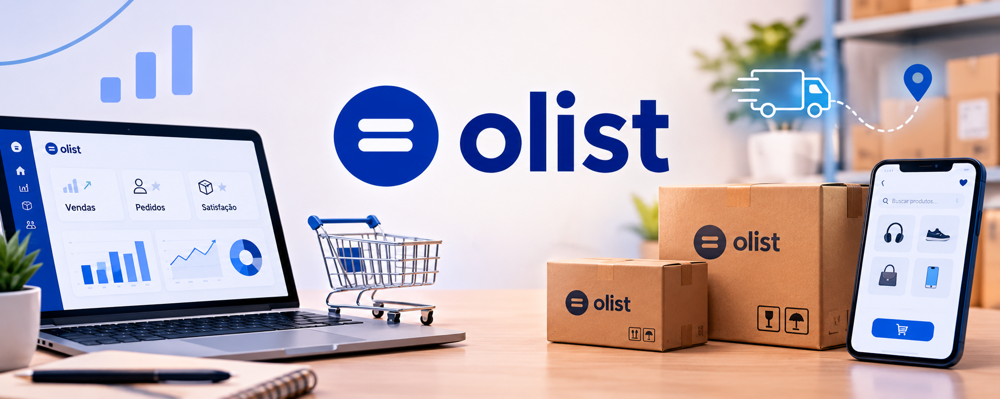
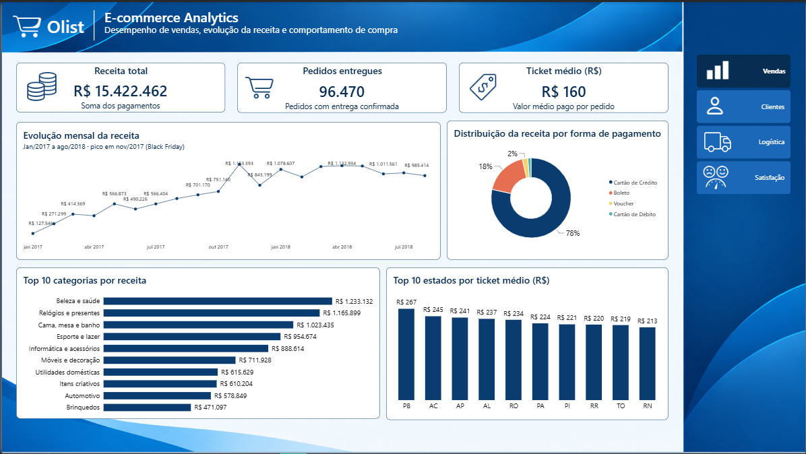
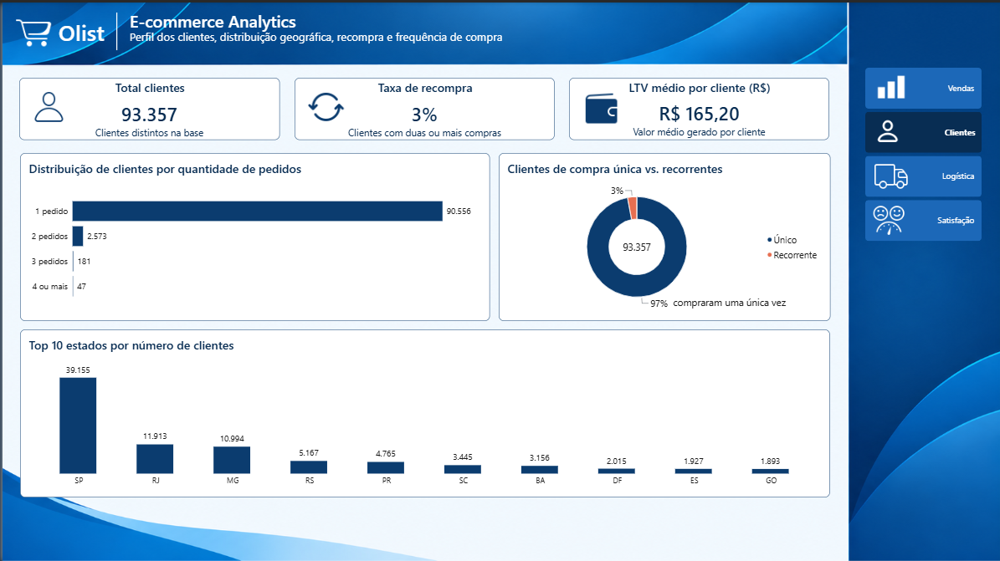
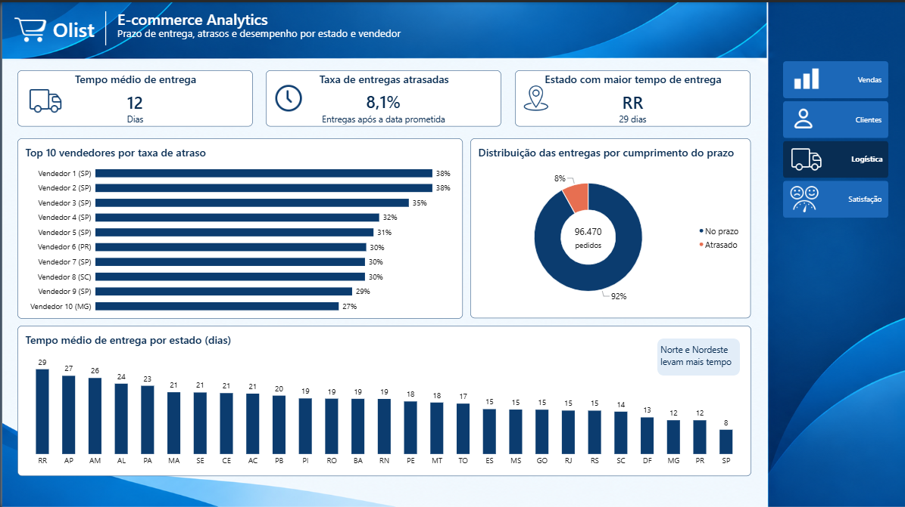
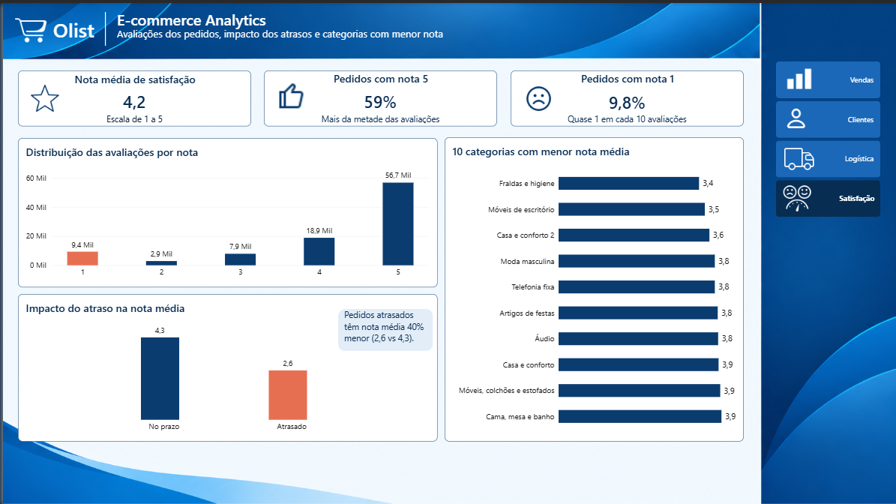

# 🛒 E-commerce Analytics — Olist 



**Onde está o dinheiro de um e-commerce e onde ele se perde?** Analisei **96.470 pedidos entregues** de um marketplace brasileiro (Olist) para descobrir. Respondi **16 perguntas de negócio em PostgreSQL** e montei um **dashboard de 4 páginas no Power BI**.


**Ferramentas:** PostgreSQL · pgAdmin 4 · Power BI Desktop
**Técnicas de SQL:** JOINs · CTEs · window functions (`ROW_NUMBER`, `LAG`) · `CASE WHEN` · `FILTER` · `HAVING` · subqueries · views · `generate_series`

---

## 📸 Dashboard

| Vendas | Clientes |
|---|---|
|  |  |

| Logística | Satisfação |
|---|---|
|  |  |

**🔗 [Acesse o dashboard completo:](https://app.powerbi.com/view?r=eyJrIjoiMWI5ZmY2ZTctYWRmNC00YmFkLThmYTgtMmQ5NTI0ZjdhNGJiIiwidCI6ImE2MDk0MDk0LWY1YjEtNDU3Yi1hODE3LTM2ZmNlOTFhYTQ3NSJ9)**


---

## 1. O desafio

Uma empresa de e-commerce enfrenta quatro dificuldades:

- crescimento de receita inconsistente;
- pouca visibilidade sobre o comportamento dos clientes;
- dificuldade de identificar o que afeta satisfação e retenção;
- falta de clareza sobre o desempenho de categorias e da operação logística.

A diretoria precisa de uma visão orientada por dados para decidir. **Meu papel como analista:** estruturar a análise em SQL, entregar um dashboard executivo e transformar os números em recomendações.

**Objetivos**

1. Acompanhar a evolução da receita e o que a compõe (categorias, estados, formas de pagamento).
2. Entender o comportamento de compra dos clientes (recompra, frequência, valor por cliente).
3. Medir a eficiência logística (prazo, atraso, vendedores).
4. Relacionar logística e satisfação.

---

## 2. Dados

[Brazilian E-Commerce Public Dataset by Olist](https://www.kaggle.com/datasets/olistbr/brazilian-ecommerce) (Kaggle): pedidos de set/2016 a out/2018. Sete tabelas relacionadas importadas para o PostgreSQL:

| Tabela | Linhas | Conteúdo |
|---|---|---|
| `clientes` | 99.441 | cliente por pedido (`customer_id`) e pessoa (`customer_unique_id`), cidade, estado |
| `pedidos` | 99.441 | status e datas (compra, entrega, estimativa) |
| `itens_pedido` | 112.650 | produto, vendedor, preço e frete de cada item |
| `pagamentos` | 103.886 | forma e valor de cada pagamento |
| `avaliacoes` | 99.224 | nota (1 a 5) e comentário |
| `produtos` | 32.951 | categoria do produto |
| `vendedores` | 3.095 | estado do vendedor |

---

## 3. Regras de negócio

Definidas antes de escrever qualquer query, para manter todos os números consistentes:

- **Escopo:** só pedidos com status `delivered` entram nas análises (inclusive as avaliações).
- **Receita** = soma de `payment_value` (inclui frete). O ranking de categorias usa o valor dos itens (`price`, sem frete).
- **Ticket médio** = valor médio **por pedido**: os pagamentos de cada pedido são somados antes da média (pagamento dividido em duas formas não pode puxar o ticket para baixo).
- **Cliente** = pessoa (`customer_unique_id`). No Olist, `customer_id` muda a cada pedido; usá-lo daria 0% de recompra.
- **Cliente recorrente** = pessoa com 2 ou mais pedidos entregues.
- **Pedido atrasado** = entrega real posterior à data estimada.
- **Tempo de entrega** = dias inteiros entre a compra e a entrega.
- **Evolução mensal:** janela de jan/2017 a ago/2018. Set–dez/2016 é a fase piloto (volume irrelevante) e set–out/2018 tem quase nenhum pedido entregue no dataset (ainda em trânsito na coleta); mostrar esses meses passaria a falsa impressão de queda.
- **Rankings** de vendedores e de categorias exigem **mínimo de 20 pedidos/avaliações**, para não destacar amostras minúsculas.
- **Avaliação:** 1 por pedido (a mais recente).

---

## 4. Etapas do projeto

1. **Aquisição dos dados** — download do dataset Olist no Kaggle.
2. **Ambiente** — criação do banco e das 7 tabelas no PostgreSQL e importação dos CSVs (`02_Scripts/01_create_tables.sql`). Contagens conferidas com o original.
3. **Limpeza e validação** (`02_Scripts/02_limpeza_validacao.sql`) — nulos, duplicidade, datas, valores impossíveis e texto malformado. Quatro inconsistências encontradas e tratadas **por views, sem alterar as tabelas originais**:
   - 610 produtos sem categoria → `nao_informado`
   - 8 pedidos "entregues" sem data de entrega → fora das análises de logística
   - 547 pedidos com 2 avaliações → mantida a mais recente
   - 9 pagamentos com valor ≤ 0 → excluídos
4. **Análise em SQL** (scripts `03` a `07` em `02_Scripts/`) — 16 perguntas de negócio.
5. **Modelagem analítica** (`02_Scripts/08_modelagem_bi.sql`) — views consolidadas para o Power BI (fato de pedidos, calendário, métricas por cliente, valor por pedido etc.).
6. **Dashboard no Power BI** — 4 páginas, tema próprio (`03_Dashboard/tema-ecommerce-olist.json`), navegação por botões.
7. **Validação** (`02_Scripts/kpis_validacao.sql`) — cada KPI do dashboard recalculado em SQL.

---

## 5. As 16 perguntas de negócio

| # | Pergunta | Onde é respondida | SQL |
|---|---|---|---|
| 1 | Como a receita evolui mês a mês? | **Vendas** · Evolução mensal da receita (linha) | `03` Q1 |
| 2 | Quais categorias geram mais receita e têm maior ticket médio? | **Vendas** · Top 10 categorias por receita. Ticket médio por categoria: só em SQL | `03` Q2 |
| 3 | Quais produtos geram mais receita? | Só em SQL (o dataset não tem nome de produto) | `03` Q3 |
| 4 | Qual o ticket médio por estado? | **Vendas** · Top 10 estados por ticket médio (colunas) | `03` Q4 |
| 5 | Quais formas de pagamento mais contribuem para a receita? | **Vendas** · Forma de pagamento (rosca) | `03` Q5 |
| 6 | Como os clientes se distribuem geograficamente? | **Clientes** · Top 10 estados com mais clientes (colunas) | `04` Q6 |
| 7 | Qual a taxa de recompra? | **Clientes** · KPI Taxa de recompra + rosca únicos x recorrentes | `04` Q7 |
| 8 | Qual a receita média por cliente (LTV aproximado)? | **Clientes** · KPI LTV médio por cliente | `04` Q8 |
| 9 | Qual a frequência de compra? | **Clientes** · Distribuição de clientes por quantidade de pedidos (barras) | `05` Q9 |
| 10 | Qual o tempo médio entre compras? | Só em SQL (window function `LAG`) | `05` Q10 |
| 11 | Qual o tempo médio de entrega por estado? | **Logística** · Tempo médio por estado (colunas) + KPI geral | `06` Q11 |
| 12 | Qual a taxa de pedidos atrasados? | **Logística** · KPI Taxa de atraso + rosca no prazo x atrasado | `06` Q12 |
| 13 | Quais estados e vendedores mais atrasam? | **Logística** · Top 10 vendedores por taxa de atraso (barras) + KPI estado com maior tempo de entrega | `06` Q13 (e Q11) |
| 14 | Como se distribuem as avaliações? | **Satisfação** · Distribuição das notas (colunas) + KPIs de nota | `07` Q14 |
| 15 | Qual a relação entre atraso e avaliação? | **Satisfação** · Atraso x nota (colunas) | `07` Q15 |
| 16 | Quais categorias têm pior avaliação? | **Satisfação** · Top 10 categorias com pior avaliação (barras) | `07` Q16 |

As perguntas 3 e 10 foram respondidas em SQL, mas **não viraram gráfico**: a primeira porque o dataset não tem nome de produto (só um código ilegível), a segunda porque é um número isolado (veja os resultados abaixo).

---

## 6. O dashboard (4 páginas)

### Página 1 — Vendas & Receita
- **Cartões:** Receita total (R$ 15,42 Mi) · Pedidos entregues (96,47 mil) · Ticket médio (R$ 160)
- **Gráficos:** evolução mensal da receita (linha) · forma de pagamento (rosca) · Top 10 categorias por receita (barras horizontais) · Top 10 estados por ticket médio (colunas)

### Página 2 — Clientes & Comportamento
- **Cartões:** Total de clientes (93.357) · Taxa de recompra (3%) · LTV médio por cliente (R$ 165,20)
- **Gráficos:** distribuição de clientes por quantidade de pedidos (barras horizontais) · clientes únicos x recorrentes (rosca) · Top 10 estados com mais clientes (colunas)

### Página 3 — Logística & Entrega
- **Cartões:** Tempo médio de entrega (12 dias) · Taxa de atraso (8,1%) · Estado com maior tempo de entrega (RR, 29 dias)
- **Gráficos:** Top 10 vendedores com maior taxa de atraso (barras horizontais) · pedidos no prazo x atrasados (rosca) · tempo médio de entrega por estado (colunas, 27 estados)

### Página 4 — Satisfação do Cliente
- **Cartões:** Nota média de satisfação (4,2) · Pedidos com nota 5 (59%) · Pedidos com nota 1 (9,8%)
- **Gráficos:** distribuição das notas de 1 a 5 (colunas) · atraso x nota de avaliação (colunas) · Top 10 categorias com pior avaliação (barras horizontais)

**Recursos:** tema personalizado, botões de navegação entre as páginas e filtro cruzado entre os visuais ligados no modelo de dados.

---

## 7. Principais resultados

**Vendas**
- A receita cresce de jan/2017 até o pico de **nov/2017 (R$ 1,15 Mi, Black Friday)**, recua em dezembro e se estabiliza perto de R$ 1,0–1,1 Mi por mês até ago/2018.
- **Cartão de crédito concentra 78% da receita**; boleto, 18%.
- `beleza_saude`, `relogios_presentes` e `cama_mesa_banho` lideram a receita (R$ 1,23 Mi, R$ 1,17 Mi e R$ 1,02 Mi). A categoria `pcs` tem o maior ticket médio (R$ 1.098,92), mas só 199 itens vendidos.
- O ticket médio por estado é maior no Norte/Nordeste (PB, R$ 266,60), em parte porque o valor pago inclui o frete.

**Clientes**
- **Só 3% dos clientes compram mais de uma vez**; ~97% compram uma única vez.
- A receita média por cliente (R$ 165,20) fica próxima do valor de uma única compra, reflexo direto da baixa recompra.
- São Paulo concentra mais de 40% dos clientes.
- Quem recompra volta, em média, após **78,8 dias** (análise em SQL).

**Logística**
- **8,11% dos pedidos chegam atrasados** (7.826 de 96.470).
- O prazo médio é de 12 dias, mas o Norte/Nordeste é bem mais lento: RR 29 dias (base pequena, 41 pedidos), AP 27, AM 26 — contra 8 dias em SP.
- **7 dos 10 vendedores com maior taxa de atraso são de SP** (de 27% a 37,5% dos pedidos). O atraso não é só distância: há problema operacional em vendedores específicos.

**Satisfação**
- **O atraso derruba a nota: 4,29 no prazo contra 2,57 atrasado (≈ 40% menos).** É o fator de insatisfação mais forte entre os analisados.
- A nota média é **4,2**: **59%** das avaliações são nota 5 e **9,8%** (quase 1 em cada 10) são nota 1.
- `fraldas_higiene` e `moveis_escritorio` têm as menores notas médias. `cama_mesa_banho`, 3ª em receita, tem nota média abaixo da geral (≈ 3,9): vende muito, mas satisfaz menos.

---

## 8. Recomendações

1. **Investir em retenção.** Com 97% dos clientes comprando uma única vez, qualquer ganho de recompra aumenta a receita sem custo de aquisição. O intervalo de ~79 dias entre compras é uma boa referência para disparar campanhas de reativação.
2. **Tratar a redução de atrasos como prioridade nº 1 de satisfação.** O salto de 2,57 para 4,29 na nota mostra que investir em logística tem retorno direto e mensurável.
3. **Auditar os vendedores de SP com maior taxa de atraso.** Como não é explicado por distância, a causa é operacional (prazo de despacho, estoque, processo).
4. **Revisar a logística do Norte/Nordeste:** prazos estimados mais realistas e alternativas de distribuição regional, já que frete e prazo são os maiores.
5. **Revisar a qualidade das categorias de alto volume e nota baixa** (`cama_mesa_banho`, `moveis_escritorio`).
6. **Planejar a Black Friday** (estoque e capacidade logística): o pico de nov/2017 foi seguido de queda em dezembro.

---

## 9. Decisões de projeto e limitações

- **Mapa descartado.** O mapa do Power BI confundiu siglas de estados brasileiros com americanas (ex.: PA, MA) e plotou pontos nos EUA. Troquei por colunas dos 10 maiores estados, que comunicam melhor.
- **Sem nome de produto nem de vendedor no dataset.** O "Top produtos" ficou só em SQL. Os vendedores aparecem anonimizados como "Vendedor N (UF)", mantendo o estado, que faz parte do insight.
- **Receita total inclui frete**; o ranking de categorias usa o valor dos itens (sem frete). Por isso as categorias não somam a receita total.
- **Ticket médio por estado inclui frete**, que é mais caro para regiões distantes. Estados com menos pedidos têm média menos estável.
- **Receita total x evolução mensal:** o cartão soma todos os pedidos entregues; a linha mensal cobre só jan/2017 a ago/2018. Por isso a soma dos meses fica um pouco abaixo do total.
- **Avaliação é por pedido, não por produto.** A nota de uma categoria é a nota dos pedidos que contêm itens dela (cada pedido conta uma vez por categoria).
- **Tempo de entrega e intervalo entre compras em dias inteiros** (parte inteira da diferença entre as datas).
- **Estado do cliente:** quando a mesma pessoa tem pedidos em estados diferentes, o dashboard usa um deles.
- **LTV aproximado:** receita média por cliente no período do dataset, não uma projeção.
- **Estado com maior tempo de entrega (RR):** baseado em 41 pedidos; é o maior prazo médio, mas com amostra pequena.
- **8 pedidos "entregues" sem data de entrega** ficam fora das análises de logística (96.470 pedidos) e dentro das de receita (96.478), diferença sem efeito prático.

---

## 10. Como reproduzir

1. Baixe o dataset no [Kaggle](https://www.kaggle.com/datasets/olistbr/brazilian-ecommerce) e descompacte os CSVs (não versionados neste repositório).
2. Crie o banco (`CREATE DATABASE ecommerce_olist;`) e rode **em ordem** os arquivos da pasta `02_Scripts/`:
   `01` (tabelas) → importe os CSVs (pgAdmin *Import/Export* ou `\copy`, comandos no final do `01`) → `02` → `03` → `04` → `05` → `06` → `07` → `08`.
3. No Power BI Desktop, conecte ao PostgreSQL (modo Import), carregue as views do `08` e as tabelas `itens_pedido`, `vendedores`, `clientes` e `vw_produtos`, e aplique o tema `03_Dashboard/tema-ecommerce-olist.json`.
4. Rode `02_Scripts/kpis_validacao.sql` e compare com os cartões do dashboard.

---

## 11. Estrutura do repositório

```
ecommerce-analytics-olist/
├── README.md
├── 02_Scripts/
│   ├── 01_create_tables.sql         # tabelas + importação
│   ├── 02_limpeza_validacao.sql     # qualidade dos dados + views de tratamento
│   ├── 03_queries_vendas.sql        # perguntas 1 a 5
│   ├── 04_queries_clientes.sql      # perguntas 6 a 8
│   ├── 05_queries_comportamento.sql # perguntas 9 e 10
│   ├── 06_queries_logistica.sql     # perguntas 11 a 13
│   ├── 07_queries_satisfacao.sql    # perguntas 14 a 16
│   ├── 08_modelagem_bi.sql          # views para o Power BI
│   └── kpis_validacao.sql           # KPIs do dashboard em SQL
├── 03_Dashboard/
│   ├── dashboard_ecommerce_olist.pbix
│   └── tema-ecommerce-olist.json
├── 04_Imagens/                      # prints das 4 páginas e  1 imagem 
```

---

## 12. Autora

**Suzy** · [github.com/suzyanebr](https://github.com/suzyanebr)

Projeto de portfólio em análise de dados. Dados: Olist (Kaggle), licença CC BY-NC-SA 4.0, usados aqui para fins educacionais e sem fins comerciais.
